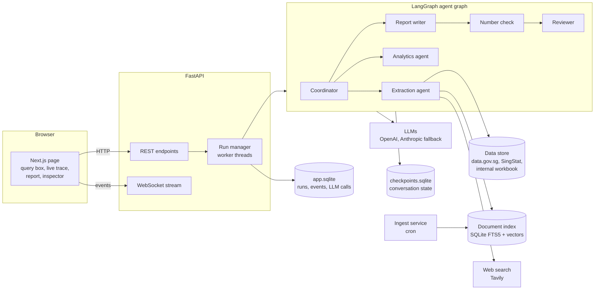
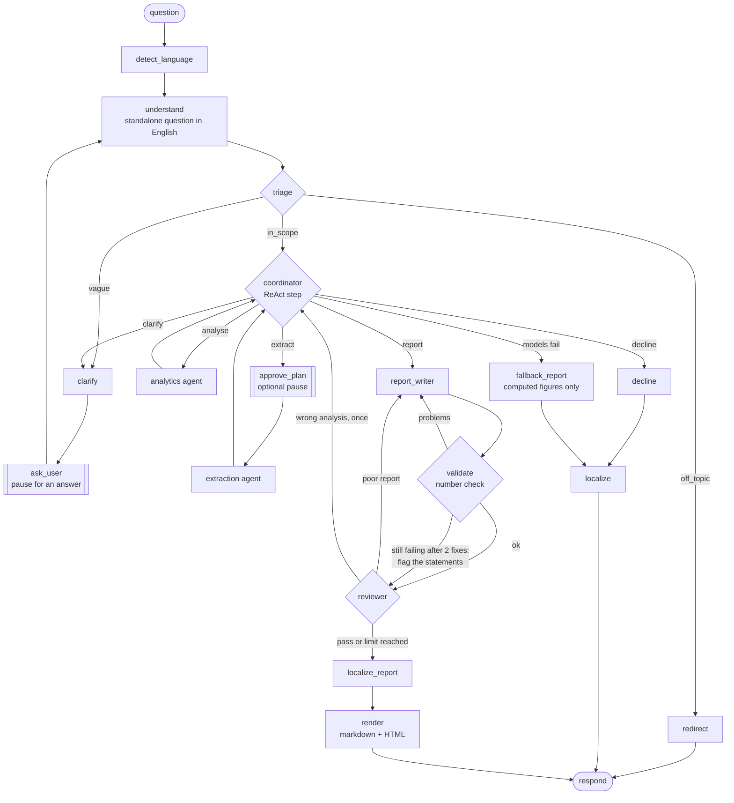
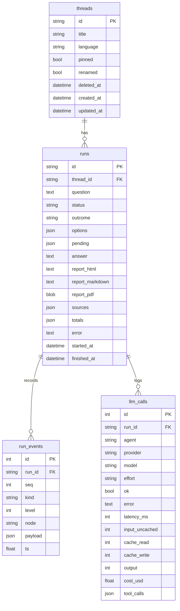
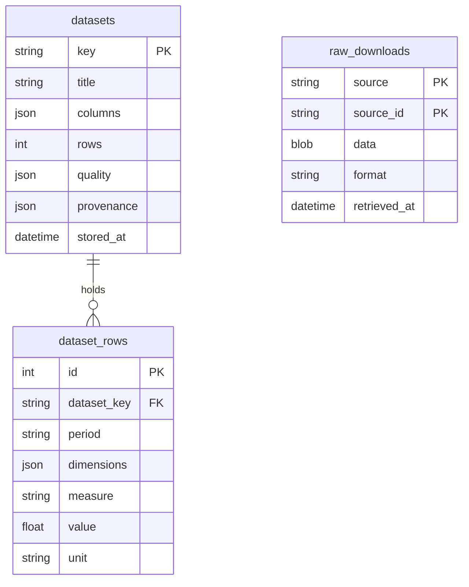

# Architecture

How the system is built and why. The decisions behind each part, with the alternatives considered, are in
[docs/DECISIONS.md](docs/DECISIONS.md) (D-001 to D-032).

## 1. Overview

A user asks a policy question in plain language. A team of agents finds official data, computes the statistics
with pandas, and writes a cited report. Every number in the report is checked in code against what was computed.

| Part | Where | Technology |
|---|---|---|
| Web UI | `frontend/` | Next.js 16, TypeScript, one page |
| API | `backend/app/api/` | FastAPI, WebSocket, SQLAlchemy on SQLite |
| Agent graph | `backend/app/graph/` | LangGraph `StateGraph`, SQLite checkpoints |
| Agents and tools | `backend/app/agents/` | ReAct tool loops over LangChain chat models |
| Statistics and charts | `backend/app/analysis/` | pandas, Plotly chart specs |
| Data | `backend/app/data/` | data.gov.sg and SingStat APIs, Excel, snapshots |
| Documents (RAG) | `backend/app/rag/` | trafilatura, SQLite FTS5, sqlite-vec, fastembed |
| LLM layer | `backend/app/llm/` | OpenAI (primary) and Anthropic (fallback), usage ledger |
| Guardrails | `backend/app/guardrails/` | PII screen, language detection, triage classifier |
| Report check | `backend/app/quality/`, `graph/nodes/reporting.py` | number and citation grounding |
| Reports | `backend/app/report/` | Jinja2 HTML with Plotly |
| Evaluations | `backend/app/evals/` | retrieval and answer evaluations, LLM-as-judge |

## 2. The agent workflow

One question is one run of a LangGraph `StateGraph`. The conversation's state is checkpointed per thread in
SQLite, so any request can continue any conversation (requests are stateless) and a run can pause for the user.

| Node | What it does |
|---|---|
| `detect_language` | Detects English, Chinese, Malay or Tamil (lingua). Short follow-ups keep the previous language. |
| `understand` | Rewrites a follow-up as a self-contained English question (fast LLM). A first message in English is used as is. |
| `triage` | Classifies the question as in scope, vague or off topic. The default is a local classifier (embeddings + logistic regression, 3 ms) that sends uncertain cases (confidence < 0.6) to the fast LLM. Jev or the LLM can be chosen per request. |
| `clarify` / `ask_user` | Writes one clarifying question with two to four answers to pick from, then pauses the run (LangGraph `interrupt`) until the user picks one or writes their own ("Other"). At most 2 per question. |
| `redirect` | Explains the scope in the user's language. No LLM call. |
| `coordinator` | A ReAct agent: each step returns a `thought`, an `action` (extract, analyse, clarify, decline, report) and `instructions`. At most 6 steps. It sees the curated dataset list, the agents' summaries, and what the state records as loaded and computed. A decline before any search is turned into a search of documents and the web, so an announced policy is found rather than declined. |
| `approve_plan` | Optional (Plan mode; Auto is the default): pauses before any data is fetched. The user approves, or rejects with or without feedback, which sends the coordinator back to plan again and pause again. Cancel stops the run through the API. |
| `extraction` | A tool-using agent (at most 6 tool calls) that loads datasets and searches documents and the web. |
| `analytics` | A tool-using agent (at most 12 tool calls) that computes statistics and charts. Every number is recorded as a fact F1, F2… |
| `report_writer` | Writes a structured report (title, summary, findings, caveats, charts). Every finding and caveat cites its facts and sources. |
| `validate` | **Deterministic**: every number must match a computed fact (within 1%) or appear in a source the same statement cites (its text, notes, quality report or dates); every citation must exist. Problems go back to the writer, quoting the words around each number (at most 2 fixes). What still fails is kept and flagged ⚠, never dropped. |
| `reviewer` | The other provider's model checks two things: does the report answer the question, and does each statement's citation support it (rankings, direction, periods, causes, attribution)? Unsupported statements go back to the writer (sharing the 2 fixes); the analysis can be sent back once. What remains is shown as flags on the report. |
| `localize_report` | Translates the report field by field into the user's language. If any number changes, the English report is kept. |
| `render` | Writes the answer as markdown, and the report as a self-contained HTML page. |
| `fallback_report` | Only when the language models fail before a report exists: the computed figures as a template, with no generated prose. |

**ReAct in practice.** The coordinator reasons about the next action, and the two worker agents run their own
reason, act, observe loops (`agents/tool_loop.py`). Each tool call carries a short `reason`, which the UI shows
as the live status line. Each tool result is fed back to the model as an observation. A failing tool call
returns `ERROR: …` with a hint, so the agent can correct itself instead of the run crashing.

**Run outcomes:**
- `answered`: every report, including one with flags. Flags mark what could not be verified and any objection
  the reviewer still has.
- `declined`: only after a search of documents and the web finds nothing that answers the question.
- `off_topic`.
- `fallback`: the template, used only when the models fail.
- `cancelled`.

A run can also pause as `awaiting_input`.

### Tools

| Agent | Tool | What it does |
|---|---|---|
| Extraction | `load_dataset` | Loads a dataset; returns its profile (measures, units, dimensions, coverage, summing rules, quality report). |
| | `search_datasets` | Hybrid search over the 4,655-dataset data.gov.sg catalogue, for topics the curated set does not cover. |
| | `search_documents` | Hybrid search over agency documents; returns citable passages D1, D2… At most 3 per task. |
| | `web_search` | Tavily, over the whole web; returns untrusted passages W1, W2… At most 10 per task. |
| Analytics | `describe_dataset` | Lists a dimension's values, so filters use exact labels. |
| | `compute_trend` | A series' values, change, compound annual growth, peak and year-on-year changes. |
| | `compare_groups` | Groups (e.g. industries) in one period, with shares where the measure can be added up. |
| | `rank_changes` | Ranks groups by their rise or fall between the same two periods. |
| | `compute_correlation` | Pearson correlation of two series, of levels and of period-to-period changes. |
| | `list_records` | Counts records in tables without a time dimension (e.g. planned stations). |
| | `create_chart` | A line, bar or scatter chart (Plotly spec) from the data, with its data table. A scatter chart plots two measures against each other on the same periods as `compute_correlation`. |

The tools apply each dataset's **summing rules**. A measure can be added up only across the dimensions the
dataset allows; for any other dimension, the agent must filter to one value. This stops, for example, adding up
medians or counting a total row twice. Users can switch optional tools off per request (`graph/options.py`).

## 3. Keeping reports grounded

The rule everything depends on: **the language model never computes a number.** pandas computes, every result is
a numbered fact, and the report may only state numbers that match a fact or appear in a cited source. In layers:

1. **Prompts.** The analytics agent must use tools for every number. The report writer must use only the facts,
   source notes and passages it is given, with no background knowledge, and cite every statement.
2. **Structure.** The report is a pydantic schema in which findings and caveats each carry citations.
3. **Code.** The `validate` node checks every number and citation (`quality/grounding.py`) and sends problems
   back to the writer, quoting where each one is. A statement that still fails after two fixes is kept, marked
   ⚠ with what could not be verified, so nothing the agents found is lost and nothing unverified passes as
   checked.
4. **Translation guard.** A translated report must keep every number, or the English one is shown.
5. **Claim check.** The reviewer, a model from the other provider, checks each statement against what it cites:
   comparisons and rankings ("largest", "alone"), direction (rose or fell), periods and definitions, causes and
   attribution. Unsupported statements go back to the writer. Those still unsupported after the fixes are
   flagged ⚠ for the reader, never dropped.
6. **Search results are data.** Passages and web pages are marked as source material, never instructions, to
   resist prompt injection. Web results are labelled untrusted.

How well this works is measured in [TESTING.md](TESTING.md#hallucination-detection).

## 4. LLM layer

| Tier | Used for | Primary | Fallback |
|---|---|---|---|
| quality | coordinator, agents, report writer, reviewer | Claude Sonnet 5.5 | GPT 6.1 Sol |
| fast | question rewrite, triage escalation, clarifying questions, translation, conversation titles | gpt-6-luna | claude-haiku-5-5 |
| check | the reviewer and claim checker: the other provider, so a model never checks its own writing | GPT 6.1 Sol | Claude Sonnet 5.5 |

- **Fallback.** Each call tries the primary provider (one retry), then the other provider's model at the same
  price (`llm/providers.py`, LangChain `with_fallbacks`). Structured output uses each provider's native mode.
  `FORCE_PRIMARY_FAIL=true` makes every primary call fail, to demonstrate the fallback.
- **Per-request options.** The user can choose the main model (its fallback is set automatically), the reasoning
  effort (default low), the tools and the triage method. The UI's menu offers Claude Sonnet 5.5 (default) and
  GPT 6 Luna (faster and cheaper, with Claude Haiku 5.5 as its fallback); the API and CLI accept all four models.
- **Ledger.** Every call is recorded (`llm/ledger.py`) with:
  - provider, model and effort
  - latency and success
  - tokens: uncached input, cache reads, cache writes, output
  - cost, from a dated price table
  - the tools requested
  - an estimate of what filled the context window: system prompt, task, the agent's own messages, tool results,
    retrieved passages, tool definitions

  The UI's inspector shows all of it.
- **Provider endpoints** come from the app's own settings, never from ambient environment variables.

## 5. Data layer

Details of every source are in [DATA_SOURCES.md](DATA_SOURCES.md).

- **Load order** (`data/store.py`): a fresh cache (under 24 hours old), then the live source, then a stale
  cache, then the committed snapshot. The cache is a set of tables in the application database
  (`data/database.py`, section 8): each cleaned dataset row by row, with its quality report and provenance, and
  every raw download, kept for auditing and re-cleaning. Snapshots are files in the repository, so a fresh install
  works offline. Each loaded dataset carries its provenance: origin, retrieval time, licence,
  and a warning when a fallback was used. `FORCE_SOURCE_FAIL=true` skips live sources, to demonstrate the
  fallback.
- **Cleaning** (`data/cleaning.py`, `data/registry.py`): every dataset is reshaped into one tidy form,
  `period | dimensions | measure | value | unit`. Each step that drops or changes a row is counted in a quality
  report:
  - periods are normalised (`2024-Q1`, `FY2024`)
  - numbers are parsed, with placeholders (`na`, `-`) counted as missing
  - duplicates and "Total" rows are removed
  - labels that differ only in letter case are merged
  - personal data columns are dropped (CEA salesperson names)

  Agents read the quality report in each dataset's profile and cite it in caveats.
- **19 curated datasets** have hand-written cleaners, summing rules and caveats. Beyond them, the extraction
  agent can search and load any of the 4,655 catalogue datasets; their shape is inferred automatically, and they
  are marked uncurated.

## 6. Documents (RAG)

- **Ingest** (`rag/ingest.py`, run by a separate cron service, `rag/scheduler.py`):
  - **Discovery:** each agency's sitemap, newest pages first (up to 500 per agency).
  - **Crawling:** robots.txt is honoured, with a delay between requests.
  - **Extraction:** main text with trafilatura.
  - **Chunking:** passages of about 350 tokens with a one-paragraph overlap. Parliamentary replies repeat their
    question in every chunk header.
  - **Embedding:** bge-small-en-v1.5, run locally (fastembed).
  - **Refresh:** re-crawls are incremental. Unchanged pages are skipped by content hash.
- **Index** (`rag/index.py`): one SQLite file holds the documents, FTS5 (BM25 keyword search) and sqlite-vec
  (vector search). The ingest service writes while the API reads (WAL). Access from the API's threads is
  serialised by a lock.
- **Search** (`rag/search.py`): keyword and vector results are merged by reciprocal rank fusion (k = 60), with
  at most 2 passages per document. A local cross-encoder reranker is available but **off by default**: on the
  retrieval evaluation it ranked worse and added 0.5 s per search (D-031).
- **Web search** (`rag/web.py`): Tavily, over the whole web, with at most 10 searches per extraction task. The
  agents prefer official sources and say when a source is a third party. Results are de-duplicated by normalised
  URL.

## 7. API and live updates

| Method | Path | Purpose |
|---|---|---|
| GET | `/api/health`, `/api/health/ready` | liveness; readiness (database, keys, index, web search) |
| GET | `/api/options` | models, tools, efforts, triage methods, verbosity levels, defaults |
| POST, GET | `/api/threads`, `/api/threads?q=…` | start a conversation; list conversations (pinned first), or those with the words in their title or a question |
| PATCH, DELETE | `/api/threads/{id}` | rename or pin a conversation; delete it (a soft delete: hidden from every route, kept for `python -m app.admin restore`; 409 while a run is working) |
| GET | `/api/threads/{id}` | a conversation's messages and runs |
| POST | `/api/threads/{id}/messages` | ask a question: **202** with a run ID; 400 if it contains personal data; 409 if a run is active |
| POST | `/api/runs/{id}/resume` | answer a clarifying question, or approve or revise a plan |
| POST | `/api/runs/{id}/cancel` | stop a run |
| GET | `/api/runs/{id}`, `/api/runs/{id}/events?after=N` | status, answer, totals and LLM call log; stored events |
| WS | `/api/runs/{id}/stream?after=N` | replay events after N, then follow the run live |
| GET | `/api/runs/{id}/report.html`, `.md`, `.pdf` | the report (HTML served with a Content-Security-Policy); downloads: Markdown with chart images, PDF with clickable citations |
| GET | `/api/search`, `/api/datasets`, `/api/datasets/{key}` | try retrieval; list and profile curated datasets |

Interactive documentation is at `http://localhost:8000/docs` when the API runs.

**Runs are asynchronous.** A message starts a background run in a worker thread and returns at once. The graph
streams trace events, each stored with a per-run sequence number before it is sent. So a browser that connects
late, reconnects or reopens history replays the same events and sees the same view.

**Runs survive a restart.** A run's worker thread dies if the API stops. When the API starts, any run still marked
"running" continues from its last checkpoint (LangGraph saves one after every step), so only the step that was cut
off runs again; the trace notes "Server restarted: continuing from the last saved step". A run is continued once:
if it is cut off again, or nothing is left to run, it ends as failed and asks the user to try again. Stop also
closes a run whose worker is gone.

**Trace events** (`graph/events.py`) have a level: 1 Normal, 2 Thinking, 3 Verbose. The UI filters them by the user's
chosen verbosity.

| Level | Kinds |
|---|---|
| 1 (Normal) | `status` (the one-line live status), `action`, `error`, `usage` (running tokens and cost), `draft` (the report so far, readable), `reply` (the user's answers), `end` |
| 2 (Thinking) | `reasoning`, `observation` |
| 3 (Verbose) | `thinking`, `context` (an agent's context window) |

**Before anything reaches a model**, the message is screened for personal identifiers by regular expressions
and a Luhn check: NRIC/FIN, email addresses, phone numbers, unit numbers, bank accounts and card numbers. A match
is rejected with a message in the user's language, and nothing is stored or sent.

## 8. Database schema

Runtime state lives in `var/` (never committed), as three SQLite databases plus model files.

**`var/app.sqlite`** (SQLAlchemy): the application database. It holds what the API and UI list, replay and audit
(`api/db.py`), and the datasets the agents analyse (`data/database.py`).

`run_events` has a unique `(run_id, seq)`. Run status is one of `running`, `awaiting_input`, `completed`,
`failed` or `cancelled`. Each dataset is replaced as a whole when it is fetched again; its rows can be queried
with SQL (for example `json_extract(dimensions, '$.town')`), though the agents read whole tables into pandas.

**`var/checkpoints.sqlite`**: LangGraph's checkpointer holds each thread's conversation state. That includes the
messages, the current question, the coordinator's steps, the findings (facts, sources, charts) and the report.
It is serialised with an allow-list of the app's own types.

**`var/rag/index.sqlite`** (`rag/index.py`):

| Table | Contents |
|---|---|
| `documents` | url (unique), source, agency, doc_type, title, published, lastmod, content_hash, fetched_at |
| `chunks` | document_id, position, header, text, tokens |
| `chunks_fts` | FTS5 over header and text (porter stemming) |
| `chunks_vec` | sqlite-vec, 384-dimension embeddings |
| `ingest_runs` | each crawl: source, times, pages seen, new, updated, unchanged, skipped, failed |
| `meta` | the embedding model and dimension; a mismatch refuses to search |

**Other state in `var/`:**
- `models/`: embedding and reranker weights
- `reports/`: HTML reports from the CLI
- `evals/`: saved evaluation material

## 9. Frontend

One client-rendered Next.js page (`frontend/app/page.tsx`):
- **Logic.** `lib/runState.ts` is a pure, unit-tested reducer that turns a run's events into what is shown:
  - the steps, at the chosen verbosity
  - the status line with elapsed working time (pauses excluded), tokens and cost
  - the streamed draft and its check stage
  - each agent's latest context window

  `lib/useRunStream.ts` follows a run's WebSocket and reconnects from the last event. `lib/useConversation.ts`
  holds the conversation and its runs.
- **Report.** The API's HTML page runs in a sandboxed iframe: scripts on, no same-origin access. It posts only
  its height to the parent page.
- **Inspector.** A side panel shows each agent's context window by category and the LLM call log.
- **Controls.**
  - The model menu, with an Effort submenu, sits beside the send button.
  - The + menu has a switch per tool.
  - The mode is Auto, or Plan (pause for plan approval).
  - The sidebar can be hidden. It has a search box (titles and questions, searched by the API), and each
    conversation's ⋮ menu pins, renames or deletes it (keys P, R, D). ⌘⇧O or Ctrl+Shift+O starts a new one.

  These choices and the Detail level are remembered in the browser. Triage is a server setting.
- **Citations.** The report's frame never scrolls, so a citation click inside it asks the page to scroll the
  conversation to the cited fact or source.
- **Titles.** Conversation titles are written by the fast model in the background (`api/titles.py`).

## 10. Security and privacy

- **Secrets.** Keys live only in `.env`, which is gitignored and entered through `scripts/set_keys.py` with
  hidden input. Docker images never contain `.env`.
- **Personal data.** It is rejected before any model call (section 7). Datasets that identify individuals (CEA
  salesperson names and registration numbers) have those columns dropped on load.
- **Prompt injection.** Search results are labelled as source material, never instructions. Web pages are marked
  untrusted, and reports prefer government documents.
- **Report pages.** Served with a Content-Security-Policy: scripts only inline and from cdnjs (Plotly, with SRI),
  and no network connections. In the UI they are also sandboxed.
- **Containers.** They run as unprivileged users.
- **Authentication: not built (D-040).** The API has no login. It is meant for one user on their own machine:
  browsers may call it only from the configured UI origin (CORS), but anything that can reach port 8000 can use
  it and spend the LLM budget. The production path:
  - **Sign-in** through the organisation's identity provider (OpenID Connect single sign-on), so no passwords
    are stored here.
  - **A session cookie** (HttpOnly, SameSite) rather than a token in a header: the report frame, the download
    links and the WebSocket are loaded by the browser itself and cannot add headers.
  - **Ownership and roles.** Conversations gain an owner, and every query filters by it. An analyst role sees
    its own work; an administrator role restores deleted conversations (today `app.admin`, run on the server).
    Shared team spaces would be a later step.
  - **Accountability.** Runs already record every step, model call and cost; adding the user to each run gives
    an audit trail by person and a per-user cost budget in front of the run manager (section 11).

## 11. Scaling and production

What this design would need in order to serve many users:

- **Throughput is set by the language models, not the server.** With the default model, a question takes
  about 35–70 seconds and costs about $0.05–0.30. With scripted models, 20 concurrent runs complete in 0.6 s with
  no lost events. Read and search endpoints sustain about 290 requests per second on a laptop (TESTING.md).
- **Stateless requests.** Conversation state is in the checkpointer and run history in the database, so API
  processes can be added behind a load balancer. The SQLite files would become PostgreSQL (LangGraph has a
  Postgres checkpointer; SQLAlchemy needs only a new URL). The vector index would move to pgvector or a vector
  database.
- **Background runs.** These are threads inside the API process. At scale, a job queue (e.g. Celery or Arq on
  Redis) with separate workers would replace them, and the WebSocket would follow events from the database or
  Redis pub/sub. The event model would not change. Restart recovery assumes one API process; with several, each
  run would need a lease (a heartbeat the owning worker renews) so a process only continues runs whose owner
  has stopped.
- **Cost control:**
  - a fast model for small tasks
  - the local triage classifier
  - per-task search budgets
  - step and revision limits
  - one reviewer send-back
  - prompt caching (visible as cache reads in the call log)
  - per-run cost shown live

  A per-user budget would sit in front of the run manager.
- **Data freshness.** Datasets are cached for 24 hours, and documents are re-crawled nightly. Every report says
  where each dataset came from, when it was retrieved, and whether a fallback was used.
