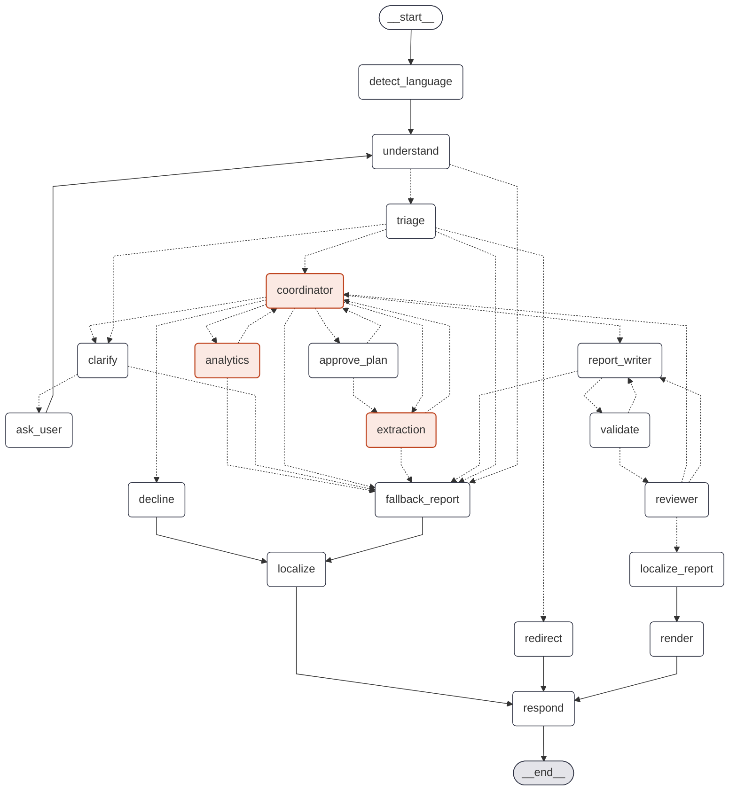

# Agentic Policy Data Analytics

Ask a policy question about Singapore in plain language, for example "How has employment in the information and
communications sector changed since 2019?". A team of AI agents answers it:

1. The agents find the official datasets and documents.
2. pandas computes the statistics.
3. The agents write a report with charts (line, bar, grouped and stacked bar, pie, box, dot, heatmap, scatter, and
   maps of Singapore) and citations.
4. Code checks every number in the report against the computation before you see it.

You can watch the agents work live: each step, the reasoning behind it, tokens and cost, and what each agent was
given to read.

**Demo video** (4½ minutes, narrated, with captions): Plan mode and the plan approval, the agents at work, a report
and its Detail levels, the Inspector (each agent's context window, and every LLM call's tokens and cost), triage of an
off-topic question, then HDB prices, COE premiums, the 2025 general election and the haze, each on real data. Waiting
for the agents is shown sped up.

https://github.com/user-attachments/assets/4a49a5db-b7ac-4873-8d0c-3e6647caa335

Full quality (1080p, 18 MB): [download it from the v1.0.4 release](https://github.com/garygsw/agentic-policy-analytics/releases/download/v1.0.4/policy-demo.mp4).

**What it does**
- **Answers from official data.** 22 curated datasets from MOM, HDB, URA, LTA, MOH, NEA, ELD, IMDA, SingStat and
  NASA (fire hotspots across Southeast Asia), plus
  search over all 4,655 data.gov.sg datasets, about 3,000 agency documents and the web.
- **Grounded reports.**
  - Every number must match a computed fact or a cited source, and every finding and caveat is cited.
  - A second model, from the other provider, checks each statement against what it cites.
  - A statement that still fails after two revisions stays in the report, marked ⚠ with what could not be
    verified. Nothing is dropped.
  - Reports download as Markdown, with the charts as images, or as PDF, with clickable citations.
- **Agents that plan and recover.**
  - A ReAct coordinator directs an extraction agent and an analytics agent.
  - A reviewer checks the result.
  - Vague questions get a clarifying question. A question is declined only after searching documents and
    the web finds nothing. Off-topic questions are redirected.
- **Resilience.**
  - **LLM providers:** Anthropic (Claude Sonnet 5.5) is the default, and OpenAI takes over automatically.
  - **Data sources:** a failing live source falls back to a cache, then to a snapshot.
  - **Messages with personal data** (NRIC, phone numbers and so on) are rejected before any model sees them.
- **Four languages:** English, Chinese, Malay and Tamil. Reports are translated, with every number checked.
- **Skills.** Playbooks for common analyses (haze and fires, places on a map, spreads, shares, change across
  groups, elections) that the agents read when a question fits, so they take the proven route.
- **Measured quality.** Evaluations score the reports for groundedness, retrieval quality, faithfulness
  (LLM-as-judge) and consistency. Load is tested too. See [TESTING.md](TESTING.md).

## Architecture


![How the agents work together on one question, in swimlanes: the user asks; intake checks the language and scope (or asks a clarifying question); the coordinator (Claude Sonnet 5.5, ReAct) decides each step, sending the extraction agent to load datasets and search documents and the web, then the analytics agent to compute statistics and charts; then the report writer cites facts and sources, a number check in code and a reviewer from the other provider send it back to fix (at most twice), and the checked report reaches the user.](docs/diagrams/orchestration.png)


The diagrams are editable HTML and SVG in [docs/diagrams](docs/diagrams/); the images are exported from them.

A question becomes a background run of a LangGraph state graph:
- The coordinator decides each step: extract, analyse, clarify, decline or report.
- The extraction and analytics agents call tools; every number comes from pandas.
- The report writer cites facts, and a deterministic check verifies them.
- A reviewer reads the result, and the report is rendered as HTML.

Events stream to the browser over a WebSocket and are stored, so a run can be replayed. Details: [ARCHITECTURE.md](ARCHITECTURE.md).

### The agent graph

The nodes and edges of the LangGraph `StateGraph`, drawn by LangGraph from the compiled graph
(`uv run python -m app.graph.diagram`; a test keeps this copy the same as the code). Solid arrows always follow;
dotted ones are chosen by a routing function. The coordinator, extraction and analytics agents are highlighted.
[ARCHITECTURE.md](ARCHITECTURE.md#2-the-agent-workflow) names each route.



## Quick start with Docker

Requires Docker Desktop (or Docker with Compose v2), Python 3 and git. Two API keys are required, for Anthropic and
OpenAI; Tavily (web search) and LangSmith (tracing) are optional. The deploy script explains each one, with how to
get it and what it looks like.

```bash
git clone https://github.com/garygsw/agentic-policy-analytics.git
```

```bash
cd agentic-policy-analytics && python3 scripts/deploy.py
```

That one command:
1. checks that Docker is installed and running;
2. asks for the required keys that are missing (input hidden), with step-by-step instructions, an example of each
   key's shape and its usual length, and offers the optional ones the first time;
3. checks each key with its provider (free calls), and stops if a required key is rejected;
4. builds and starts the API, the web UI and the ingest service;
5. waits until they answer, then starts building the document index in the background the first time.

Run it again at any time: keys already set are not asked for, and only what changed is rebuilt. `--keys` reviews
every key; `--release v1.0.4` starts the published images instead of building them. On Windows, use `python`
instead of `python3`.

Prefer to do it by hand? Copy `.env.example` to `.env` and put the keys in it, or run `python3 scripts/set_keys.py`
(and `--verify`), then `docker compose up -d --build`.

Open the UI at http://localhost:3000; the API's interactive docs are at http://localhost:8000/docs.
The API has no login (D-040), so run it on your own machine rather than on a shared network.

Runtime state (document index, models, and the database of conversations and datasets) lives in a Docker
volume, not in a folder shared with your machine, because SQLite is not safe across that boundary (D-036). The
datasets work at once, from committed snapshots or live. Document search needs the index built once: the deploy
script starts it, crawling up to 500 pages per agency (about 40 minutes), and a nightly cron job keeps it fresh. To
build it by hand:

```bash
docker compose run --rm ingest python -m app.rag.scheduler --now
```

Deleting a conversation in the UI hides it but keeps everything (a soft delete). To list deleted conversations and
restore one:

```bash
docker compose exec api python -m app.admin deleted
```

```bash
docker compose exec api python -m app.admin restore THREAD_ID
```

## Running locally (development)

Requires Python 3.12 with [uv](https://docs.astral.sh/uv/), and Node.js 24 or later.

1. **Keys.** From the repository root, run `python3 scripts/set_keys.py`. Keys are typed hidden and saved to the
   gitignored `.env`.
2. **Backend.** In `backend/`:

   ```bash
   uv sync
   ```

   ```bash
   uv run uvicorn app.api.main:app --port 8000
   ```

3. **Frontend.** In `frontend/`, in another terminal:

   ```bash
   npm ci
   ```

   ```bash
   npm run dev
   ```

   Then open http://localhost:3000.
4. **Documents (optional).** In `backend/`, run `uv run python -m app.rag.ingest`. Add `--limit 50` for a quick
   start.
5. **Command line (optional).** In `backend/`, ask without the UI:

   ```bash
   uv run python -m app.cli "Analyse employment trends in the technology sector from 2020-2024"
   ```

   Useful flags: `--verbosity verbose` shows every step, `--calls` prints the LLM call log, and `--effort medium`
   sets the reasoning effort. HTML reports are saved in `var/reports/`.

## Sample queries

| Question | What it shows |
|---|---|
| Analyse employment trends in the technology sector from 2020-2024 | trend analysis, a chart, cited caveats (residents only) |
| How has employment in the information and communications sector changed since 2019, and how does it compare with overall employment? | comparison with the whole economy, growth rates, peak and latest change |
| Which HDB towns saw the largest rise in median resale prices since 2020? | ranking groups by their change over the same two quarters, flat type by flat type |
| How have COE premiums for Category A cars moved over the last five years? | monthly series, highs and lows, policy context from documents |
| Is there a relationship between retrenchments and GDP in the information and communications industry? | correlation of levels and of changes, with the caution that shared trends inflate it |
| Petrol cars are going to be phased out by 2030? How would that affect the COE market? | an announced policy found by web search, checked against the premise, alongside COE data |
| How many participants did each internal tech talent programme have each year, and which programme was largest? | the mock internal system, and its data-quality problems reported as caveats |
| 自2019年以来，新加坡信息通信业的就业人数有何变化？ | a question in Chinese, answered in Chinese with every number checked |

Questions that show the error handling:

| Try | What happens |
|---|---|
| What will the median HDB resale price be in 2030? | published sources are searched first; with nothing official to go on, it declines and suggests a question it can answer |
| How is Singapore doing? | a clarifying question with answers to pick from, or "Other" to write your own; the run pauses until you answer |
| What is a good recipe for chicken rice? | redirected: outside scope, with no agent run |
| My NRIC is S1234567D, how much CPF do I have? | rejected before any model sees it |

Two switches simulate failures. Set one in `.env`, restart the API, then ask any question:
- `FORCE_PRIMARY_FAIL=true`: every call to the primary provider fails, the other provider answers, and the call
  log shows both.
- `FORCE_SOURCE_FAIL=true`: live data sources are skipped, and reports say that cached or snapshot data was used.

In the chat bar:
- The **+** menu has a switch for each optional tool.
- **Mode** is **Auto** (the default) or **Plan**, which pauses for your approval before any data is fetched.
  The plan card has **Approve** and **Reject**. Reject stops the run, and **Review plan** reopens it later, with
  both buttons again. Typing what should change shows **Submit**, which brings back a revised plan to approve.
- The model menu beside the send button sets the model and its effort.

**Detail** sets how much of the trace you see: Normal, Thinking or Verbose. In a report, clicking a citation
scrolls to its fact or source, and source links open in a new tab. The sidebar can be hidden with the button at
its top. The search box finds conversations by words in their titles or questions. Each conversation's ⋮ menu
pins, renames or deletes it (deleted conversations can be restored from the backend; see above). **New**, or
⌘⇧O (Ctrl+Shift+O), starts a new conversation, and ⌘K (Ctrl+K) jumps to the search. The list shows 15
conversations, with **View more** for the next 15. Drag the sidebar's edge to resize it (double-click resets it).

## Running the tests

The tests need no API keys and make no network calls: the language models are scripted.

From `backend/`:

| What | Command |
|---|---|
| All unit and integration tests (197) | `uv run pytest` |
| With line coverage (80%) | `uv run pytest --cov=app` |
| Lint | `uv run ruff check app tests scripts` |
| Real provider calls (costs cents) | `uv run pytest -m live` |
| Retrieval evaluation (free) | `uv run python -m app.evals.retrieval run` |
| Answer evaluation (real models, about $4) | `uv run python -m app.evals.answers` |
| HTTP load test (needs the API running) | `uv run python scripts/load_test.py` |

From `frontend/`:

| What | Command |
|---|---|
| Unit tests | `npm test` |
| Type check | `npm run typecheck` |
| Production build | `npm run build` |

GitHub Actions runs the backend and frontend checks on every push, then builds both Docker images, starts them
and smoke-tests them. On version tags, it publishes the images. The test plan, the hallucination-detection
method and all results are in [TESTING.md](TESTING.md).

## Technology choices

| Choice | Why |
|---|---|
| **LangGraph** for the agents | An explicit graph you can draw and test route by route. Checkpoints make requests stateless and let a run pause for the user (clarifying questions, plan approval) and resume later, even after a restart. A run cut off by a restart continues from its last step. |
| **ReAct coordinator and tool-using agents** | The coordinator decides each step from what has been found, so it can retry, change approach, ask, or decline. A fixed pipeline cannot. |
| **pandas computes; the model never does** | Numbers are the part users must be able to trust. Every number is a computed fact with an ID, and the report check enforces it in code. |
| **OpenAI primary, Anthropic fallback** | Two independent providers at the same price tier, behind one interface. Each request can pick the model and its reasoning effort. |
| **FastAPI + WebSocket** | Async endpoints, background runs, and a stream of numbered events that late viewers can replay. Interactive API docs come for free. |
| **SQLite** (app data, checkpoints, FTS5 + sqlite-vec index) | One file per store, nothing to operate, and enough for one machine. The scaling path to PostgreSQL and pgvector is in ARCHITECTURE.md. |
| **Hybrid search** (BM25 + local embeddings, rank fusion) | Keyword search finds scheme names and figures; vectors find paraphrases. Fusion beat either alone, and beat adding a reranker, on our retrieval evaluation. |
| **Local triage classifier, LLM when unsure** | 99% accurate on held-out questions in 3 ms, at a quarter of the cost of always asking an LLM. |
| **Next.js + TypeScript**, one page | A live trace needs client state. A pure reducer turns events into the view, so live and replayed runs look the same. |
| **Reports: HTML, Markdown and PDF** from one structure | The HTML (Plotly charts) is shown in the chat. The downloads (charts drawn with matplotlib, PDF with fpdf2) are built from the same state, with pure-Python libraries and no system dependencies. |
| **Docker Compose, GitHub Actions** | Starts with one command. CI tests everything and smoke-tests the images on each push. |

Every decision, with the alternatives considered, is in [docs/DECISIONS.md](docs/DECISIONS.md).

## Configuration

Settings are read from `.env`; see `.env.example`. The keys:

| Setting | Default | Purpose |
|---|---|---|
| `OPENAI_API_KEY`, `ANTHROPIC_API_KEY` | | required: the two providers (each is the other's fallback) |
| `TAVILY_API_KEY` | | optional: the web search tool |
| `TYPESAFE_API_KEY` | | optional: only for the triage trial's Jev comparison |
| `FIRMS_MAP_KEY` | | optional: only to rebuild the fire-hotspot snapshot (`scripts/make_hotspots.py`) |

Model selection:

| Setting | Default | Purpose |
|---|---|---|
| `LLM_QUALITY_PRIMARY` / `LLM_QUALITY_FALLBACK` | `claude-sonnet-5-5` / `gpt-6.1-sol` | the agents' models |
| `LLM_FAST_PRIMARY` / `LLM_FAST_FALLBACK` | `gpt-6-luna` / `claude-haiku-5-5` | short tasks: triage, translation, rewrites |
| `LLM_REASONING_EFFORT` | `low` | default effort; each request can override it |

Data and documents:

| Setting | Default | Purpose |
|---|---|---|
| `DATA_MAX_AGE_HOURS` | `24` | how long cleaned data is reused before fetching again |
| `INGEST_CRON`, `INGEST_SINCE`, `INGEST_LIMIT_PER_SOURCE` | `0 3 * * *`, `2024-01-01`, `500` | the document crawl schedule and depth |
| `RAG_RERANK` | `false` | cross-encoder reranking (off: it ranked worse in evaluation) |
| `CLAIM_CHECK` | `true` | the reviewer checks each statement against what it cites (off: cheaper and faster) |

Demo switches:

| Setting | Default | Purpose |
|---|---|---|
| `FORCE_PRIMARY_FAIL` | `false` | make the primary provider fail |
| `FORCE_SOURCE_FAIL` | `false` | make live data sources fail |

Logs and tracing (see [Observability](#observability)):

| Setting | Default | Purpose |
|---|---|---|
| `LOG_FORMAT` | `text` | `json` writes one JSON object per line, for a log platform |
| `LOG_LEVEL` | `INFO` | the lowest level logged |
| `LANGSMITH_TRACING`, `LANGSMITH_API_KEY`, `LANGSMITH_PROJECT` | off | optional LangSmith tracing (sends prompts and data to LangSmith) |

Deployment (also read by Docker Compose; see the next section):

| Setting | Default | Purpose |
|---|---|---|
| `PUBLIC_API_URL` | `http://localhost:8000` | where browsers reach the API; built into the web image |
| `API_CORS_ORIGINS` | `["http://localhost:3000"]` | the UI's address, if it differs from the API's |
| `BIND_ADDRESS` | `0.0.0.0` | `127.0.0.1` keeps the ports off the network, behind a reverse proxy |

## Deployment

CI builds and smoke-tests both images on every push. For each version tag (`v1.0.0`, ...), it also publishes them
to the GitHub Container Registry.

**On one machine, from the published images.** Nothing is built:

```bash
VERSION=v1.0.3 docker compose -f docker-compose.yml -f docker-compose.release.yml up -d
```

The published web image calls the API at `http://localhost:8000`, so the browser must be on the same machine.

**On a server with its own address.** The API's address is built into the web image, so build on the server:

1. Install Docker with Compose and clone the repository. Create `.env` with the keys: `python3 scripts/set_keys.py`,
   then `python3 scripts/set_keys.py --verify`. Make it readable only by you: `chmod 600 .env`.
2. Serve the UI and the API from one address, and keep the ports local. Add to `.env`:

   ```
   PUBLIC_API_URL=https://analytics.example.org
   BIND_ADDRESS=127.0.0.1
   ```

3. Start it: `docker compose up -d --build`. Then build the document index once:
   `docker compose run --rm ingest python -m app.rag.scheduler --now` (about 40 minutes; nightly after that).
4. Put a reverse proxy with TLS in front. With [Caddy](https://caddyserver.com), certificates are automatic and
   WebSockets pass through. The app has no login of its own (D-040), so the proxy asks for one:

   ```
   analytics.example.org {
       basic_auth {
           analyst <hash from: caddy hash-password>
       }
       handle /api/* {
           reverse_proxy 127.0.0.1:8000
       }
       handle {
           reverse_proxy 127.0.0.1:3000
       }
   }
   ```

   Because the UI and the API share one address, browsers need no cross-origin settings. With two addresses,
   set `API_CORS_ORIGINS` to the UI's.

**Running it:**
- **Health.** `/api/health` says the API is up (Docker uses it). `/api/health/ready` checks the database, the
  keys, the document index and web search, and answers 503 if the API cannot answer questions.
- **Logs.** `docker compose logs -f api`; set `LOG_FORMAT=json` for a log platform (see [Observability](#observability)).
- **Backups.** All state is in the `state` volume. SQLite files must not be copied while in use, so stop the
  stack first:

  ```bash
  docker compose stop && docker run --rm -v policy-analytics_state:/state:ro -v "$PWD:/backup" alpine tar czf /backup/state.tgz -C /state . && docker compose start
  ```

- **Upgrades.** `git pull`, then `docker compose up -d --build` (or a new `VERSION` with the published images).
  New database columns are added on start-up, and analyses cut off by the restart continue from their last step
  (D-041).
- **Rolling back.** Check out the previous tag (or set the previous `VERSION`) and run the same command. Restore
  the backup if the newer version wrote data the older one should not see.
- **Keys.** They live only in `.env` on the server, never in images or the repository. To rotate one, edit `.env`
  and run `docker compose up -d`.

**Limits of this setup:** one machine, SQLite, and runs inside the single API process, so do not run several API
replicas (D-041). For many users, see "Scaling and production" in ARCHITECTURE.md.

## Observability

Three layers, from built in to optional:

- **Every run, in the app.** Each step of a run is stored as an event, so a run can be replayed
  (`GET /api/runs/{id}/events`). Every LLM call is recorded with its agent, provider, model, tokens, cost and
  latency, and what filled the model's context. The web UI's Inspector shows them, and `GET /api/runs/{id}` returns
  them.
- **Logs for a log platform.** With `LOG_FORMAT=json` in `.env`, the API (including the workers that run questions)
  and the ingest service write one JSON object per line, which Loki and Grafana, Datadog, ELK or CloudWatch can
  ingest as it is. `text`, the default, is for reading in a terminal. Every line has `ts` (UTC), `level`, `logger`
  and `message`. Lines written while a question is being worked on also carry its `run_id`, so one run can be
  followed end to end, and some add fields such as `agent`, `model` or `cost_usd`. Logged: each run's start and end
  (status, outcome, LLM calls, cost, seconds), every LLM call, a failed call before the other provider takes over, a
  data source falling back to stored data, and runs continued after a restart. Logs carry IDs, statuses, timings and
  costs, never questions or answers. A line from a real run:

  ```json
  {"ts": "2026-10-18T09:26:43.049+00:00", "level": "INFO", "logger": "app.runs", "message": "LLM call", "run_id": "c168fff6c3f5", "agent": "coordinator", "provider": "anthropic", "model": "claude-sonnet-5-5", "ok": true, "latency_ms": 4213, "input_tokens": 2615, "output_tokens": 252, "cost_usd": 0.00775}
  ```

  To follow one run in Docker:

  ```bash
  docker compose logs api --no-log-prefix | grep '"run_id": "RUN_ID"'
  ```

- **LangSmith (optional).** The agents run on LangChain and LangGraph, so `LANGSMITH_TRACING=true`,
  `LANGSMITH_API_KEY` and `LANGSMITH_PROJECT` in `.env` trace every graph step and LLM call in LangSmith, with no code
  change (`LANGSMITH_ENDPOINT` selects another region, and `LANGSMITH_WORKSPACE_ID` names the workspace when a key
  can reach several). This sends prompts and data to LangSmith, so leave it off
  where data must stay in your environment. Personal data is still rejected before anything reaches a model or a
  trace.

## Repository layout

```
backend/
  app/
    api/         FastAPI: endpoints, background runs, WebSocket, the API's database tables
    graph/       LangGraph: state, nodes (intake, coordinator, workers, reporting), prompts, events
    agents/      tool-using agents and their tools
    analysis/    statistics (pandas), charts (Plotly), the workspace of facts and sources
    data/        sources, curated dataset registry and cleaners, the store and its database tables
    rag/         document crawl, chunking, index, hybrid search, web search, scheduler
    llm/         providers and fallback, usage ledger, pricing, fake models for tests
    guardrails/  personal-data screen, language detection, triage classifier
    quality/     number grounding
    report/      HTML report template, Markdown and PDF downloads
    evals/       retrieval and answer evaluations
    database.py  the application database (one SQLite file for both sets of tables)
    cli.py       command-line interface
    admin.py     list and restore deleted conversations
  data/          snapshots, catalogue, mock internal workbook, evaluation sets and results
  tests/         unit/ and integration/ (pytest)
  scripts/       snapshots, mock data, triage trial, load test
frontend/        Next.js UI (app/, components/, lib/)
docs/            DECISIONS.md: every design decision
scripts/         set_keys.py: enter and verify API keys
ARCHITECTURE.md  TESTING.md  DATA_SOURCES.md
docker-compose.yml  docker-compose.release.yml (published images)  .github/workflows/ci.yml
```

## Data and licences

The code is released under the [MIT Licence](LICENSE). The data is not covered by it: it contains information
from data.gov.sg, made available under the
[Singapore Open Data Licence v1.0](https://data.gov.sg/open-data-licence). The internal workbook is synthetic,
made for this project. Sources, APIs and licences are listed in [DATA_SOURCES.md](DATA_SOURCES.md).
