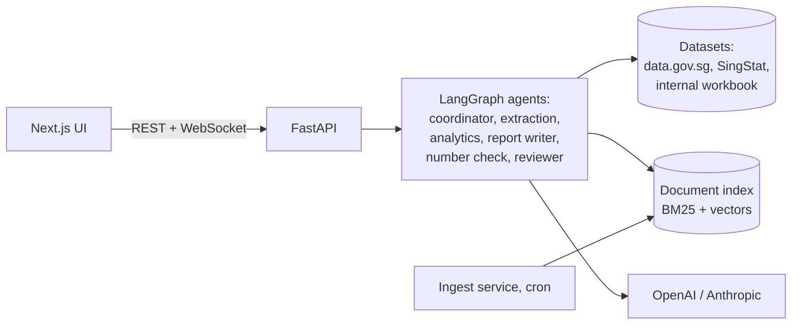

# Agentic Policy Data Analytics

Ask a policy question about Singapore in plain language, for example "How has employment in the information and
communications sector changed since 2019?". A team of AI agents answers it:

1. The agents find the official datasets and documents.
2. pandas computes the statistics.
3. The agents write a report with charts and citations.
4. Code checks every number in the report against the computation before you see it.

You can watch the agents work live: each step, the reasoning behind it, tokens and cost, and what each agent was
given to read.

> Demo video: *to be added.*

**What it does**
- **Answers from official data.** 19 curated datasets from MOM, HDB, URA, LTA, MOH, IMDA and SingStat, plus
  search over all 4,655 data.gov.sg datasets, about 3,000 agency documents and the web.
- **Grounded reports.**
  - Every number must match a computed fact or a cited source, and every finding and caveat is cited.
  - A second model, from the other provider, checks each statement against what it cites.
  - A statement that still fails after two revisions stays in the report, marked ⚠ with what could not be
    verified. Nothing is dropped.
  - Reports download as Markdown, with the charts as images, or as PDF, with clickable citations.
- **Agents that plan and recover.**
  - A ReAct coordinator directs an extraction agent and an analytics agent.
  - A reviewer checks the result.
  - Vague questions get a clarifying question. A question is declined only after searching documents and
    the web finds nothing. Off-topic questions are redirected.
- **Resilience.**
  - **LLM providers:** Anthropic (Claude Sonnet 5.5) is the default, and OpenAI takes over automatically.
  - **Data sources:** a failing live source falls back to a cache, then to a snapshot.
  - **Messages with personal data** (NRIC, phone numbers and so on) are rejected before any model sees them.
- **Four languages:** English, Chinese, Malay and Tamil. Reports are translated, with every number checked.
- **Measured quality.** Evaluations score the reports for groundedness, retrieval quality, faithfulness
  (LLM-as-judge) and consistency. Load is tested too. See [TESTING.md](TESTING.md).

## Architecture



A question becomes a background run of a LangGraph state graph:
- The coordinator decides each step: extract, analyse, clarify, decline or report.
- The extraction and analytics agents call tools; every number comes from pandas.
- The report writer cites facts, and a deterministic check verifies them.
- A reviewer reads the result, and the report is rendered as HTML.

Events stream to the browser over a WebSocket and are stored, so a run can be replayed. Details: [ARCHITECTURE.md](ARCHITECTURE.md).

## Quick start with Docker

Requires Docker with Compose, and API keys for OpenAI and Anthropic. Tavily, for web search, is optional.

```bash
git clone https://github.com/garygsw/agentic-policy-analytics.git
```

```bash
cd agentic-policy-analytics && cp .env.example .env
```

Put your keys in `.env`. Or, to type them hidden and check them with each provider, run `python3 scripts/set_keys.py`
and then `python3 scripts/set_keys.py --verify`. Then:

```bash
docker compose up --build
```

Open the UI at http://localhost:3000; the API's interactive docs are at http://localhost:8000/docs.

Runtime state (document index, caches, models, conversations) lives in a Docker volume, not in a folder shared
with your machine, because SQLite is not safe across that boundary (D-036). The datasets work at once, from
committed snapshots or live. Document search needs the index built once. This crawls up to 500 pages per agency,
which takes about 40 minutes; a nightly cron job keeps it fresh:

```bash
docker compose run --rm ingest python -m app.rag.scheduler --now
```

## Running locally (development)

Requires Python 3.12 with [uv](https://docs.astral.sh/uv/), and Node.js 24 or later.

1. **Keys.** From the repository root, run `python3 scripts/set_keys.py`. Keys are typed hidden and saved to the
   gitignored `.env`.
2. **Backend.** In `backend/`:

   ```bash
   uv sync
   ```

   ```bash
   uv run uvicorn app.api.main:app --port 8000
   ```

3. **Frontend.** In `frontend/`, in another terminal:

   ```bash
   npm ci
   ```

   ```bash
   npm run dev
   ```

   Then open http://localhost:3000.
4. **Documents (optional).** In `backend/`, run `uv run python -m app.rag.ingest`. Add `--limit 50` for a quick
   start.
5. **Command line (optional).** In `backend/`, ask without the UI:

   ```bash
   uv run python -m app.cli "Analyse employment trends in the technology sector from 2020-2024"
   ```

   Useful flags: `--verbosity verbose` shows every step, `--calls` prints the LLM call log, and `--effort medium`
   sets the reasoning effort. HTML reports are saved in `var/reports/`.

## Sample queries

| Question | What it shows |
|---|---|
| Analyse employment trends in the technology sector from 2020-2024 | trend analysis, a chart, cited caveats (residents only) |
| How has employment in the information and communications sector changed since 2019, and how does it compare with overall employment? | comparison with the whole economy, growth rates, peak and latest change |
| Which HDB towns saw the largest rise in median resale prices since 2020? | ranking groups by their change over the same two quarters, flat type by flat type |
| How have COE premiums for Category A cars moved over the last five years? | monthly series, highs and lows, policy context from documents |
| Is there a relationship between retrenchments and GDP in the information and communications industry? | correlation of levels and of changes, with the caution that shared trends inflate it |
| Petrol cars are going to be phased out by 2030? How would that affect the COE market? | an announced policy found by web search, checked against the premise, alongside COE data |
| How many participants did each internal tech talent programme have each year, and which programme was largest? | the mock internal system, and its data-quality problems reported as caveats |
| 自2019年以来，新加坡信息通信业的就业人数有何变化？ | a question in Chinese, answered in Chinese with every number checked |

Questions that show the error handling:

| Try | What happens |
|---|---|
| What will the median HDB resale price be in 2030? | published sources are searched first; with nothing official to go on, it declines and suggests a question it can answer |
| How is Singapore doing? | a clarifying question; the run pauses until you answer |
| What is a good recipe for chicken rice? | redirected: outside scope, with no agent run |
| My NRIC is S1234567D, how much CPF do I have? | rejected before any model sees it |
| Set `FORCE_PRIMARY_FAIL=true` in `.env` and restart | every call to the primary provider fails, the other provider answers, and the call log shows both |
| Set `FORCE_SOURCE_FAIL=true` in `.env` and restart | live data sources are skipped; reports say cached or snapshot data was used |

In the chat bar:
- The **+** menu has a switch for each optional tool.
- **Mode** is **Auto** (the default) or **Plan**, which pauses for your approval before any data is fetched.
- The model menu beside the send button sets the model and its effort.

**Detail** sets how much of the trace you see: Normal, Thinking or Verbose. In a report, clicking a citation
scrolls to its fact or source, and source links open in a new tab. The sidebar can be hidden with the button at
its top.

## Running the tests

The tests need no API keys and make no network calls: the language models are scripted.

From `backend/`:

| What | Command |
|---|---|
| All unit and integration tests (187) | `uv run pytest` |
| With line coverage (79%) | `uv run pytest --cov=app` |
| Lint | `uv run ruff check app tests scripts` |
| Real provider calls (costs cents) | `uv run pytest -m live` |
| Retrieval evaluation (free) | `uv run python -m app.evals.retrieval run` |
| Answer evaluation (real models, about $2) | `uv run python -m app.evals.answers` |
| HTTP load test (needs the API running) | `uv run python scripts/load_test.py` |

From `frontend/`:

| What | Command |
|---|---|
| Unit tests | `npm test` |
| Type check | `npm run typecheck` |
| Production build | `npm run build` |

GitHub Actions runs the backend and frontend checks on every push, then builds both Docker images, starts them
and smoke-tests them. On version tags, it publishes the images. The test plan, the hallucination-detection
method and all results are in [TESTING.md](TESTING.md).

## Technology choices

| Choice | Why |
|---|---|
| **LangGraph** for the agents | An explicit graph you can draw and test route by route. Checkpoints make requests stateless and let a run pause for the user (clarifying questions, plan approval) and resume later, even after a restart. |
| **ReAct coordinator and tool-using agents** | The coordinator decides each step from what has been found, so it can retry, change approach, ask, or decline. A fixed pipeline cannot. |
| **pandas computes; the model never does** | Numbers are the part users must be able to trust. Every number is a computed fact with an ID, and the report check enforces it in code. |
| **OpenAI primary, Anthropic fallback** | Two independent providers at the same price tier, behind one interface. Each request can pick the model and its reasoning effort. |
| **FastAPI + WebSocket** | Async endpoints, background runs, and a stream of numbered events that late viewers can replay. Interactive API docs come for free. |
| **SQLite** (app data, checkpoints, FTS5 + sqlite-vec index) | One file per store, nothing to operate, and enough for one machine. The scaling path to PostgreSQL and pgvector is in ARCHITECTURE.md. |
| **Hybrid search** (BM25 + local embeddings, rank fusion) | Keyword search finds scheme names and figures; vectors find paraphrases. Fusion beat either alone, and beat adding a reranker, on our retrieval evaluation. |
| **Local triage classifier, LLM when unsure** | 99% accurate on held-out questions in 3 ms, at a quarter of the cost of always asking an LLM. |
| **Next.js + TypeScript**, one page | A live trace needs client state. A pure reducer turns events into the view, so live and replayed runs look the same. |
| **Reports: HTML, Markdown and PDF** from one structure | The HTML (Plotly charts) is shown in the chat. The downloads (charts drawn with matplotlib, PDF with fpdf2) are built from the same state, with pure-Python libraries and no system dependencies. |
| **Docker Compose, GitHub Actions** | Starts with one command. CI tests everything and smoke-tests the images on each push. |

Every decision, with the alternatives considered, is in [docs/DECISIONS.md](docs/DECISIONS.md).

## Configuration

Settings are read from `.env`; see `.env.example`. The keys:

| Setting | Default | Purpose |
|---|---|---|
| `OPENAI_API_KEY`, `ANTHROPIC_API_KEY` | | required: primary and fallback providers |
| `TAVILY_API_KEY` | | optional: the web search tool |
| `TYPESAFE_API_KEY` | | optional: the Jev triage classifier |

Model selection:

| Setting | Default | Purpose |
|---|---|---|
| `LLM_QUALITY_PRIMARY` / `LLM_QUALITY_FALLBACK` | `claude-sonnet-5-5` / `gpt-6.1-sol` | the agents' models |
| `LLM_FAST_PRIMARY` / `LLM_FAST_FALLBACK` | `gpt-6-luna` / `claude-haiku-5-5` | short tasks: triage, translation, rewrites |
| `LLM_REASONING_EFFORT` | `low` | default effort; each request can override it |

Data and documents:

| Setting | Default | Purpose |
|---|---|---|
| `DATA_MAX_AGE_HOURS` | `24` | how long cleaned data is reused before fetching again |
| `INGEST_CRON`, `INGEST_SINCE`, `INGEST_LIMIT_PER_SOURCE` | `0 3 * * *`, `2024-01-01`, `500` | the document crawl schedule and depth |
| `RAG_RERANK` | `false` | cross-encoder reranking (off: it ranked worse in evaluation) |

Demo switches:

| Setting | Default | Purpose |
|---|---|---|
| `FORCE_PRIMARY_FAIL` | `false` | make the primary provider fail |
| `FORCE_SOURCE_FAIL` | `false` | make live data sources fail |

## Repository layout

```
backend/
  app/
    api/         FastAPI: endpoints, background runs, WebSocket, database
    graph/       LangGraph: state, nodes (intake, coordinator, workers, reporting), prompts, events
    agents/      tool-using agents and their tools
    analysis/    statistics (pandas), charts (Plotly), the workspace of facts and sources
    data/        sources, curated dataset registry and cleaners, cache and snapshot store
    rag/         document crawl, chunking, index, hybrid search, web search, scheduler
    llm/         providers and fallback, usage ledger, pricing, fake models for tests
    guardrails/  personal-data screen, language detection, triage classifier
    quality/     number grounding
    report/      HTML report template
    evals/       retrieval and answer evaluations
    cli.py       command-line interface
  data/          snapshots, catalogue, mock internal workbook, evaluation sets and results
  tests/         unit/ and integration/ (pytest)
  scripts/       snapshots, mock data, triage trial, load test
frontend/        Next.js UI (app/, components/, lib/)
docs/            DECISIONS.md: every design decision
scripts/         set_keys.py: enter and verify API keys
ARCHITECTURE.md  TESTING.md  DATA_SOURCES.md
docker-compose.yml  .github/workflows/ci.yml
```

## Data and licences

The code is released under the [MIT Licence](LICENSE). The data is not covered by it: it contains information
from data.gov.sg, made available under the
[Singapore Open Data Licence v1.0](https://data.gov.sg/open-data-licence). The internal workbook is synthetic,
made for this project. Sources, APIs and licences are listed in [DATA_SOURCES.md](DATA_SOURCES.md).
